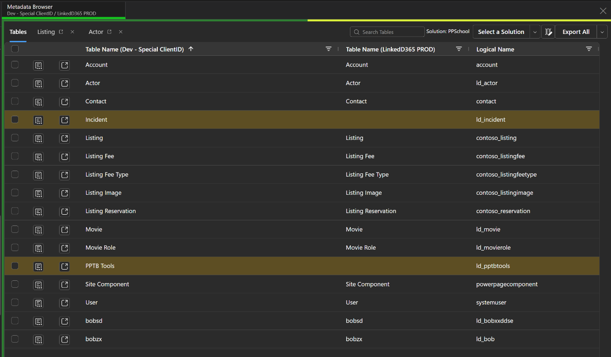

#  Metadata Browser

## Dataverse Metadata browser

This tool is a re-implementation of [Metadata Browser for XrmToolBox](https://github.com/MscrmTools/MsCrmTools.MetadataBrowser "Thanks Tanguy") with permission to use the same name.

## Features

- ✅ Ability to select from solution or all tables
- ✅ Select the details icon to create a new tab with tables details
- ✅ Select attributes you want to display
- ✅ Export to CSV
- ✅ Export to Excel
- ✅ Added Views, BPFs and Business Rules
- ✅ Search on Solutions and default sorting
- ✅ Compare metadata across up to four Dataverse environments

The solution picker and table list use the primary connection. Additional connections compare matching tables without adding tables or solutions to that selection.

This brings the original XrmToolBox workflow to PPTB and adds side-by-side comparison of metadata across up to four environments.

## What this tool does

- It allows browsing and comparing Dataverse metadata across multiple environments, including tables, views, BPFs, and business rules.

- It does not create, update, or delete Dataverse records, schema, solutions, permissions, or workflows.
- Choosing **Set Default** saves local, tool-specific display or Excel export preferences, replacing the previous defaults. You can change and save these preferences again.
- Explicit export actions create CSV or Excel files. CSV uses the host save dialog; Excel downloads one workbook per selected table. Existing-file handling is controlled by the host/browser and your chosen destination.
- Open-in-browser actions navigate to the selected table's definition in Microsoft's maker portal; any edits made there are outside this tool.

Excel workbooks contain primary-environment metadata, fetched independently of cached comparison rows. CSV detail exports contain the currently loaded rows and selected attributes. Neither export is a backup or restore mechanism.

## Privacy

Dataverse requests use Power Platform ToolBox's authenticated APIs. This tool does not send metadata, environment identifiers, personal-view definitions, or usage telemetry to publisher-controlled services and does not access connection tokens.

## Troubleshooting

If loading fails, check the notification and event log, reconnect or correct permissions, then reopen the affected metadata tab. For the table list, select the solution or **All Tables** again. Empty results are valid; unavailable permissions or failed paging are reported rather than treated as empty results.

If Excel export fails, controls become available again. Earlier workbooks may already have downloaded; check those files before retrying. Cancelled CSV save dialogs are logged as cancellation, not success.

## Latest
31/10/26 - Added bounded metadata paging, per-environment comparison targeting, tenant-data protection, and four-environment comparison using current connection settings. Solution selection and the table-list baseline come from the primary connection. Updated the tool logo and screenshot. All comparison grids use field-title prefixes and configured environment names, such as `Table Name (Development)`. Added visible error logging, export failure recovery, safely quoted CSV exports, primary-only Excel workbooks, and a manual acceptance checklist.
20/5/26 - Added open in links, Views, BPFs, Business Rules
20/1/26 - Added Export to Excel

## Implementation details

See [IMPLEMENTATION.md](./IMPLEMENTATION.md) for the implementation plan, safety behavior, and test commands.

## Manual acceptance testing

Review and complete [MANUAL_TESTS.md](./MANUAL_TESTS.md) inside PPTB before submission. The checklist is pending human completion; automated tests and a successful build do not establish live-environment acceptance.

## Credits

This is an independent reimplementation of [Metadata Browser for XrmToolBox](https://github.com/MscrmTools/MsCrmTools.MetadataBrowser), created by Tanguy Touzard (MsCRMTools). The original project is licensed under [GPL-3.0](https://github.com/MscrmTools/MsCrmTools.MetadataBrowser/blob/master/LICENSE). No original project source was copied or translated; this implementation is MIT-licensed. The original author has granted permission to reuse the tool name.

## AI assistance

AI assistance was used substantially in implementation, testing, documentation, and review. The publisher remains responsible for the code, dependencies, release decisions, and real-environment acceptance testing. Human acceptance results must be recorded in the linked manual checklist before submission.

## Installation

1. Install the tool in ToolBox
2. Load and use the tool from the ToolBox interface

The tool should be intuitive, but documentation is available on [Linked365 Blog](https://linked365.blog/metadatabrowser/). 

Please create Issues and feature requests on the [GitHub repository](https://github.com/LinkeD365/Metadata-Browser/issues).

## License

MIT
